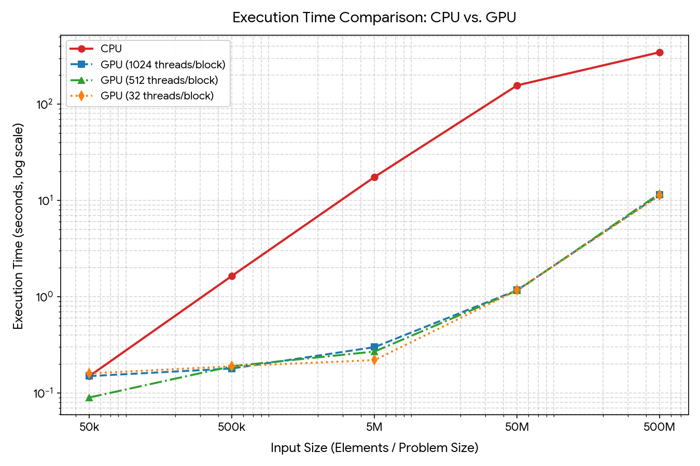

# Deliverables

## Main applications of GPU: 
Parallelized workflows, eg.:
- training NN, 3D calculations such as simulations, rendering, Operating on large amounts of data.

## Experiments
These are the results of our benchmarks:

As you can see, the CPU is much slower and as the plot is shown on a log scale, the gap between CPU and GPU performance gets wider as we increase input size.

## Architecture comparison
GPUs have multiple orders of magnitude more cores than CPUs, this allows the GPU to execute similar tasks in paralel and achieve a significant perfomance advantage as data input increases. GPUs have a different memory hiearchy.

For comparison:
| CPU | GPU |
|---|---|
| Intel Xeon w3-2525 | NVIDIA RTX PRO 4000 Blackwell |
| 16 threads | 143,360 threads |
| — | 70 SMs |
| — | 8,960 SPs |

## Race conditios
Race conditions occure when multiple threads try to write to the same piece of memory. This can be prevented by using atomic operations, or gating the used variables with semaphores or similar. 
